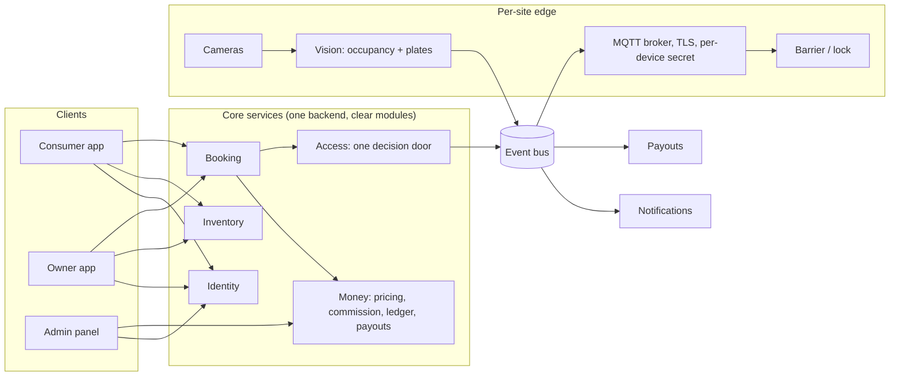

# ParkFNB: company system design, gaps and roadmap

*Written 2026-10-26 from a read-only audit of the code and every earlier report in this workspace
(Prototype V2, Barrier Control Logic, Feature Implementation Report, System Audit and Roadmap,
the Master PRD, `system-design.md`, `deploy-and-hardware-plan.md`, QA report, pilot baseline and
validation). File and line references are from that audit and can drift; re-check before acting.
This document names where secrets live, never their values.*

---

## 1. What ParkFNB is

ParkFNB is an operating layer for parking capacity that is today fragmented across private
owners, societies and commercial lots. The business loop:

**demand → verified inventory → reservation → physical access → live occupancy → settlement**

| Piece | Who it serves |
|---|---|
| Consumer app (React Native, JS) | Drivers: search, book, unlock, extend, review |
| Owner app (React Native, TS) | Owners: KYC, list spaces, approve bookings, earnings |
| Admin panel (React + Vite) | The company: users, owners, bookings, settings |
| Backend (Node, Express 5, Mongoose) | Identity, inventory, bookings, payments, device commands |
| ANPR / occupancy service (FastAPI, EC2) | Camera → which bays are free, parked correctly, which car |
| Barrier hardware (ESP32 + motor + MPU6050) | Physical gate at a lot |
| Space optimizer (Python) | Sold as a lot-layout design service |

Owner tiers map to hardware: **A** single bay (smart lock), **B** lot of 10–50 (barrier + QR),
**C** commercial 50–150+ (CCTV edge AI + ANPR).

**Revenue model (from the Master PRD and pitch deck):** 70% owner / 30% platform commission,
plus a ₹10–25 convenience fee from the driver; B2B setup fee + monthly SaaS for CCTV and
barriers; optimizer design fee; B2G long-term contracts. Pilot city: Indore.

---

## 2. What exists today, honestly

| Component | Built | Deployed | Mock / partial | Missing |
|---|---|---|---|---|
| Backend: 25 models, ~170 endpoints | Yes | Render (free tier; cold start ~24 s, was unresponsive during the audit) | Payments are mocked | Commission, ledger, scheduler, real gateway |
| Consumer app | OTP, onboarding, search, booking, unlock, reviews | No store release | Payment, wallet, subscription, EV screens are UI only | Live occupancy, plate display |
| Owner app | KYC, space wizard, queue, earnings, IoT pairing | No store release | Promotions, payouts, IoT integrations live only on the phone | Staff roles |
| Admin panel | Basic management | Unknown | Vehicles page calls an endpoint that does not exist | Reporting, audit trail |
| ANPR / occupancy | Bay status, 3D parking verdict, activity log, admin login, 584 tests | **Yes, EC2 (t3.small)** | Night: bays freeze as "too dark" | Plate reading is switched off; no link to backend |
| Barrier firmware | MQTT command, tamper stop, LEDs | Prototype only | Physical arch-lock uses an open Firebase DB | Per-unit secrets, offline path, end-stop sensors |
| ESP32-CAM (`parkfnb_cam`) | Posts a JPEG every 1.5 s | Not installed | 800×600, no IR | A real gate position |
| Space optimizer | Layout generation | Local | | Sync with live bays |

**Where the old documents disagree** (fix the source of truth before an investor reads them):

- Tests: "68 passing" (audit docx) vs 476 (pilot-validation) vs 584+ today.
- Bays rated good: 4 (audit docx) vs 6 of 7 (pilot-validation).
- Backend size: 144 / 170 / 172 endpoints and 20 / 23 / 25 models depending on the document.
- Owner app screens: 85 vs 64.
- Barrier drive: chain-and-sprocket (Feature report, Prototype V2) vs lead-screw (Enclosure doc).
- How the physical barrier is commanded: MQTT/HiveMQ vs polling Firebase every 2 s.
- State persistence: "SQLite" vs per-camera JSON files.

---

## 3. Target architecture

Principles, most of which `system-design.md` already states:

1. **One door.** The app unlock, the ANPR event and the owner override all run the same checks
   (booking exists, paid or allowed by policy, inside the time window) and each writes one
   `AccessAuditLog` row. Today there are two different rules (see gap P1-1).
2. **One `SpaceState`.** A bay's truth combines booking, device and camera. Today the camera
   bays (`bay-01…`) are not linked to `ParkingSpace` at all.
3. **ANPR is evidence, not authority.** An app unlock always works if the plate read fails;
   entry is never denied on ANPR alone (`system-design.md`, Master PRD dispute matrix).
4. **Edge does the seeing, cloud does the deciding.** Cameras and vision stay per site; the
   backend only receives clean events.
5. **Everything is auditable.** Each gate action, override and admin change is a row with who,
   when and why.

---

## 4. Gaps, by priority

### P0: security (fix before any real customer)

| # | Gap | Where |
|---|---|---|
| S1 | The test OTP is accepted for **any** phone number unless `DISABLE_TEST_OTP` is set; deployed config enables it. Anyone can sign in as anyone. | `otpController.js:61-65, 98-101, 501-507`; `render.yaml:87-94` |
| S2 | Secret values committed to git: the ANPR service token in the EC2 deploy script, the OTA password in firmware config, the test OTP in `render.yaml`. Rotate all three. | `services/anpr/deploy-ec2.sh:117`; `firmware/parkbnb_esp32/config.h:67`; `render.yaml:90` |
| S3 | `docs/status/RENDER_ENV.md` holds the database connection string with its password, the ANPR token and demo logins. It says not to commit it; treat it as leaked, rotate, delete. | `docs/status/RENDER_ENV.md` |
| S4 | MQTT falls back to the **public** HiveMQ broker and the device token is sent in clear in each payload; anyone listening can drive the barrier. | `services/mqttService.js:13, 173-176` |
| S5 | The arch-lock reads an open Firebase Realtime DB ("anyone can open the barrier"). | `firebaseBarrierService.js`; Status and Tasks doc |
| S6 | Firmware: `setInsecure()` TLS (no certificate check), OTA from any URL in a command, one shared secret for every unit. | `parkbnb_esp32` `:356, :262-283, :236-241` |
| S7 | Payment webhook has no signature check; anyone with a transaction id can mark a booking paid. | `paymentsController.js:324` |
| S8 | Rate limiting disabled; Mongo operator injection possible; uploads (including KYC documents) are served without auth and wiped on every deploy; `dev_code` can leak. | `deploy-and-hardware-plan.md` |
| S9 | `parkfnb1.pem` (EC2 key), `atlas-credentials.env` and `services/backend/.env` sit in the workspace. They are git-ignored but should live outside it. | workspace root |
| S10 | ANPR service token compared with `!==` (not constant time). | `anprAccessController.js:117-126` |

### P1: money

| # | Gap | Where |
|---|---|---|
| M1 | Payments are mocked: success is `Math.random() > 0.1`; the apps never call `/api/payments`; in practice every booking is cash. Needs Razorpay/UPI with signed webhooks. | `paymentsController.js:211`; `paymentService.js` empty |
| M2 | No commission. A `platform.commission_rate` setting exists but nothing reads it; the quote returns `service_fee: 0`; owners see 100% of gross. | `platformSettingsController.js:22`; `bookingsController.js:162`; `ownersController.js:301` |
| M3 | No ledger, escrow release (T+48 h) or weekly payouts, no GST invoice. | PRD §10-11 not built |
| M4 | Currency default is still `'USD'` in `processPayment` (models are fixed to `'INR'`). `Payment` provider/method enums list Stripe/PayPal and have no UPI or cash. | `paymentsController.js:170`; `Payment.js:39,45` |
| M5 | Two price field sets (`price_per_hour` and `hourly_rate`) kept in sync by hand; check-out overtime reads only `hourly_rate`, so a space without it gets NaN and no overtime is charged. | `ParkingSpace.js:54-79`; `bookingsController.js:1006` |

### P1: booking and gate

| # | Gap | Where |
|---|---|---|
| B1 | **ANPR denies every real booking today:** it requires `payment_status:'paid'`, which cash bookings only reach at check-out, while the app unlock lets unpaid cash bookings in. One rule is needed. | `anprAccessController.js:163-170`; `bookingAccessController.js:76` |
| B2 | Exit always sends OPEN and never checks the booking out; a car past the 30-minute window is refused at exit and trapped. | `anprAccessController.js:201` |
| B3 | Plates saved with spaces never match; no unique index; duplicate plates matched arbitrarily. | `UserVehicle`; `anprAccessController.js:149` |
| B4 | No scheduler anywhere: nothing expires pending bookings or marks no-shows. | no cron or interval in the backend |
| B5 | `checkIn` does not check payment and reads a `verification_code` field that is not on the model. | `bookingsController.js:887-948, 940` |
| B6 | Owners cannot cancel (Owner id compared with the user id); barrier lock/unlock admin check uses `req.user.role`, which does not exist; `promo_code` is silently dropped on create. | `bookingsController.js:794, 500`; `bookingAccessController.js:127, 204` |

*Already fixed since the earlier docs:* pending bookings now hold a slot for only 2 hours
(`bookingsController.js:29-48`), and the approve / reject / no-show endpoints exist
(`bookingRoutes.js:62-64`); `Booking` and `Payment` models default to INR.

### P2: operations

- **Walk-in / pay-at-gate.** Today a car can only enter with a pre-booking.
- **Camera bays are not linked to `ParkingSpace`;** occupancy is not stored in the backend. The
  uncommitted `anpr-occupancy-event` endpoint only writes an audit row.
- **Violations:** no record with evidence, no fines or penalties, no overstay billing.
- **Multi-site:** lot capacity, staff roles (owner staff screens are mocks), device fleet health
  and alerts, per-site configuration.
- **Admin:** the Vehicles page 404s (`apps/admin/src/pages/Vehicles.tsx:63`); no revenue,
  occupancy or turnover reports, no data export, no admin audit trail.

### P2: vision

- **Night.** Training data was mostly daytime; at night bays freeze as "too dark". Needs lighting
  or an IR camera plus a night fine-tune.
- **Accuracy has never been measured on labelled footage.** Until it is, no accuracy number may
  be quoted to a client.
- **Number plates are not read in the live product** (section 6).
- Camera lens distortion is ignored (k1 = k2 = 0); far bays carry larger error; the silhouette
  jitters ±8-15 cm; the camera-moved check misses slow drift.
- Two overlapping cars merge into one footprint, so some bays can only be "not judged" from
  this angle.

### P3: engineering

- No CI, no real backend test suite (`npm test` is a stub), no Docker, no staging, no monitoring.
- A large pile of **untracked** ANPR and firmware work plus scratch images; nothing of it is
  committed (a deliberate rule for the ANPR work, but it means there is no history or backup).
- The backend runs on a free Render plan that sleeps.

---

## 5. Roadmap

Each item has an owner role and an acceptance check. Months are counted from now.

### 0-30 days: make it safe and make one site honest

| Item | Owner | Done when |
|---|---|---|
| Set `DISABLE_TEST_OTP`, turn off demo modes in production; rotate S2/S3/S4 secrets; delete `RENDER_ENV.md` | Backend lead | A random number cannot sign in with the test code; old tokens refused |
| Private MQTT broker with TLS and one secret per device; lock Firebase rules | Hardware + backend | A sniffer on the public network cannot open a barrier |
| One access rule for app and ANPR (decide cash policy); check-out on exit | Backend lead | The same booking is allowed or denied identically by both paths |
| Move the EC2 key and env files out of the workspace | Founder | `parkfnb1.pem` not under the repo folder |
| Label 2-3 hours of real phone-1 footage and measure occupancy and parking-verdict accuracy | Vision lead | A written accuracy table with sample sizes |
| Fix the document contradictions in section 2 | Founder | One numbers sheet |

### 30-90 days: take money and run the pilot

| Item | Owner | Done when |
|---|---|---|
| Razorpay/UPI with signed webhooks; INR everywhere; one price field | Backend lead | A test payment settles and the webhook rejects a forged call |
| Commission and ledger; owner earnings net of commission | Backend lead | Earnings = total − platform share, reconcilable |
| Scheduler: expire pending, mark no-shows, overstay | Backend lead | A job log shows expiry running |
| Link camera bays to `ParkingSpace`; store occupancy | Backend + vision | Owner dashboard shows camera occupancy, not a booking estimate |
| Plate camera at the gate (section 6) and sessions | Vision lead | Entry/exit time and dwell for known cars, measured read rate |
| First paying pilot site (100 bays target, Indore) | Founder | Signed pilot, weekly occupancy and revenue report |

### 3-6 months: operate several sites

Weekly payouts and GST invoices; staff roles and per-site dashboards; walk-in / pay-at-gate;
violation records with photo evidence and penalty webhooks; device fleet health and alerting;
CI, staging, monitoring; night camera (IR) validated; barrier V2 with end-stop sensors and a
100-cycle test before any customer install.

### 6-12 months: scale and sell the software

ANPR plate match at CCTV lots (1,500 bays); multi-camera bird's-eye view; edge box (Jetson or
OpenVINO) where a lot is large enough to pay for it; predictive vacancy; optimizer synced with
live bays; B2B SaaS for CCTV/barrier customers; B2G conversations.

---

## 6. Number plates: what is built, what is not, and the honest limits

**Built** (`services/anpr`): a YOLO model that finds vehicles and plates, an Indian-format
normaliser that fixes look-alike letters and digits by position, and an OCR step.
**Not working in the live product:**

- Plate reading is **off on EC2** (`ANPR_OCR=none`): EasyOCR needs about 0.5 GB more than the
  2 GB box has.
- Even with OCR on, the live path locks the **first** valid read for a car (no vote across
  frames), drops the plate from bay events, never writes it to the activity log, and keeps no
  entry / exit / dwell record.
- The only route that sends a plate to the backend is a manual single-photo upload.

**Measured on 2026-10-26 on the live phone-1 view:** the plate detector found **0 plates** in
three real frames at 960, 1280 and 1920 detection sizes. Looking at the picture, the nearest
car's plate is about 36 × 8 pixels, a car at the far end about 20 × 5; letters are about 5
pixels tall. Plate OCR needs roughly 20 pixels of letter height. **From this camera position the
plates cannot be read, and no software change to the reader will fix that.**

What it takes (in order of cost):

1. A second, cheap phone or camera at the entry, 2-3 m from where the plate passes, pointing at
   the plate, 1280×720 or better. The car must be slow or stopped.
2. Night needs an 850 nm infrared illuminator or a proper ANPR camera; Indian plates are
   retroreflective.
3. A plate-specific ONNX recogniser (a few MB) in place of EasyOCR so it runs on the current
   server, with voting across 3+ frames per car, and sessions (entry, bay, exit, dwell).
4. Only after measured accuracy on labelled plates: connect to the backend gate decision, with
   the app unlock always available as the fallback.

Plates are personal data: admin-only, never on the public page, text only, with a retention
limit.

---

## 7. KPIs a parking company should track

| KPI | Can the system produce it today? |
|---|---|
| Occupancy % per site and per hour | **Yes** (summary and per-minute samples) |
| Bay availability uptime / stream health | **Yes** (stream status, frame age, fps) |
| Parked correctly vs over the line | **Yes**, for bays where the camera fit is good (about 3-6 of 7 now) |
| Average dwell and turnover | Partly: bay events exist; per-car dwell needs plates or tracks |
| Plate read rate | **No** (plates not read) |
| Revenue per bay per day, GBV, take rate | **No** (payments mocked, no commission) |
| No-show and cancellation rate | Partly (states exist, nothing expires them) |
| Violations and fines | **No** |
| Device uptime | Partly (barrier `last_state`; no fleet view) |
| Camera accuracy against labels | **No** (never measured) |
